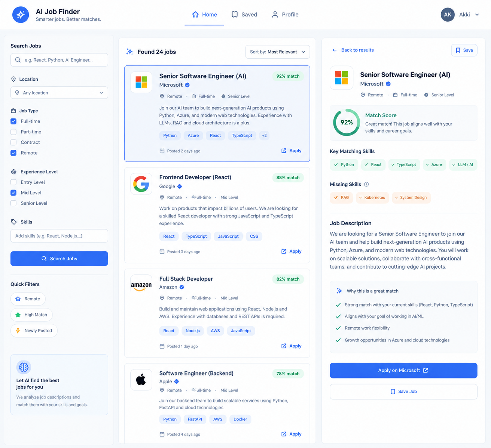

# NextRole.ai — AI Job Finder

An AI-powered job finder that pulls real job listings, compares them with your profile and resume, and shows a **match score**, **matching / missing skills**, and **reasons why a role fits you**.

This is a learning project covering full-stack development (React, Node.js, SQL Server) and applied AI (LLMs, structured outputs, embeddings) end to end.



---

## Table of Contents

- [Architecture](#architecture)
- [Tech Stack](#tech-stack)
- [Project Structure](#project-structure)
- [Roadmap](#roadmap)
  - [Phase 1 — Node API + SQL Server with mock data](#phase-1--node-api--sql-server-with-mock-data)
  - [Phase 2 — Real jobs from an external API](#phase-2--real-jobs-from-an-external-api)
  - [Phase 3 — Profile section](#phase-3--profile-section)
  - [Phase 4 — AI layer](#phase-4--ai-layer)
  - [Phase 5 — Polish](#phase-5--polish)
- [How the AI Match Works](#how-the-ai-match-works)
- [UI ↔ Data Mapping](#ui--data-mapping)
- [Database Schema](#database-schema)
- [Production Deployment](#production-deployment)
- [Getting Started](#getting-started)
- [Learning Tips](#learning-tips)

---

## Architecture

```
React (UI)  ──►  Node.js + Express (main API)  ──►  SQL Server
                        │
                        ▼
                Python + FastAPI (AI service)  ──►  Ollama (local) / OpenAI
```

| Layer                 | Responsibility                                                                                                    |
| --------------------- | ----------------------------------------------------------------------------------------------------------------- |
| **React**             | UI only. Talks **only** to the Node API.                                                                          |
| **Node.js + Express** | Owns users, profiles, jobs, saved jobs, and all SQL Server access. Fetches jobs from external APIs on a schedule. |
| **SQL Server**        | Stores jobs, profiles, and cached AI match results.                                                               |
| **Python + FastAPI**  | Stateless AI service: receives `{ profile, job }`, returns the analysis. Never touches the database directly.     |
| **Ollama / OpenAI**   | The LLM. Ollama runs locally for free; OpenAI is used for comparison.                                             |

> **One codebase for both LLMs:** Ollama exposes an OpenAI-compatible endpoint at `http://localhost:11434/v1`.
> Write the AI code once with the `openai` Python SDK and switch providers by changing only `base_url` and the model name.

```python
from openai import OpenAI

# Local (free) — Ollama
client = OpenAI(base_url="http://localhost:11434/v1", api_key="ollama")
MODEL = "llama3.1:8b"   # or "qwen2.5:7b"

# Cloud — OpenAI
# client = OpenAI()      # reads OPENAI_API_KEY from .env
# MODEL = "gpt-4o-mini"
```

---

## Tech Stack

| Area             | Tools                                                   |
| ---------------- | ------------------------------------------------------- |
| Frontend         | React 19, Vite, Tailwind CSS, CSS Modules               |
| Backend API      | Node.js, Express, `mssql`, `node-cron`                  |
| Database         | SQL Server                                              |
| AI service       | Python ≥ 3.10, FastAPI, Pydantic, `openai` SDK, `pypdf` |
| LLMs             | Ollama (`llama3.1:8b` / `qwen2.5:7b`), OpenAI           |
| Package managers | npm (JS), uv (Python)                                   |

---

## Project Structure

A **monorepo**: one repository, one folder per service. Each service is self-contained — its own dependencies, its own `.env`, and (later) its own `Dockerfile`. The root only holds what ties the services together.

```
job-finder/
├── frontend/          # React (Vite)
├── jobs_api/          # Node.js + Express + SQL Server
├── ai-service/        # Python + FastAPI
├── database/          # SQL schema / migrations
├── docker-compose.yml # starts all services together (later)
├── .gitignore
└── README.md
```

### Restructure checklist (current repo → target layout)

- [ ] **Remove root `package.json` / `node_modules`** — `tailwindcss`, `@tailwindcss/vite`, and `lucide-react` belong to the frontend:
  ```bash
  cd frontend && npm install tailwindcss @tailwindcss/vite
  ```
  The frontend currently works only because Node resolves packages from parent folders; a fresh clone or production build would fail.
- [ ] **Move Python files into `ai-service/`** — `main.py`, `utils/` (incl. the Remotive prototype), `pyproject.toml`, `uv.lock`
- [ ] **Add a root `.gitignore`** — `node_modules/`, `.env`, `__pycache__/`, `.venv/`, `dist/`
- [x] **Create `jobs_api/`** with a basic Express setup

---

## Roadmap

Build in phases — **each phase should run on its own before starting the next.**

### Phase 1 — Node API + SQL Server with mock data

- [ ] Set up Express server and SQL Server connection
- [ ] Create tables: `users`, `profiles`, `jobs`, `saved_jobs`, `job_matches`
- [ ] Move the mock jobs from `JobListings.jsx` into SQL Server (seed script)
- [ ] Routes:
  - `GET /api/jobs` — list with filter query params (location, type, level, skills)
  - `GET /api/jobs/:id` — single job
  - `POST /api/saved` / `DELETE /api/saved/:jobId` — save / unsave
  - `GET /api/profile` / `PUT /api/profile`
- [ ] Fetch from React; wire filters, sorting, and selected job to real data

**You learn:** REST API design, SQL, connecting frontend ↔ backend.

### Phase 2 — Real jobs from an external API

- [ ] Pick a source:
  - **Remotive** — free, remote jobs (already prototyped in `utils/jobs_api.py`)
  - **Adzuna** — free tier, many countries
  - **JSearch** (RapidAPI) — aggregates many boards
  - **Greenhouse / Lever** public job-board APIs — many companies use them
- [ ] Fetch on a schedule with `node-cron`, store in SQL Server, de-duplicate by `(source, external_id)`
- [ ] Never call the external API on every page load — serve from SQL Server

> ⚠️ Don't scrape LinkedIn or Indeed — it violates their terms and will get blocked.

**You learn:** third-party APIs, scheduled jobs, data cleaning and de-duplication.

### Phase 3 — Profile section

- [ ] Profile page: text area for skills and career goals
- [ ] Resume upload (PDF)
- [ ] Node stores the file → sends it to Python → Python extracts text with `pypdf`
- [ ] Save the extracted text and a `profile_version` in SQL Server

### Phase 4 — AI layer

The core learning part. See [How the AI Match Works](#how-the-ai-match-works).

- [ ] FastAPI endpoint `POST /analyze` taking `{ profile, job }`
- [ ] Extraction step with structured JSON output + Pydantic validation
- [ ] Deterministic scoring in code
- [ ] (Optional) embedding similarity
- [ ] LLM-written explanation
- [ ] Cache results in `job_matches`
- [ ] Compare Ollama vs OpenAI on the same test cases

**You learn:** prompt design, structured outputs, embeddings, why LLMs shouldn't do the math, and caching.

### Phase 5 — Polish

- [ ] Authentication (JWT)
- [ ] Loading states and error handling in the UI
- [ ] Run AI analysis as a background task so the UI never blocks
- [ ] Optional: Docker Compose to start everything with one command

---

## How the AI Match Works

> **Don't ask the LLM to "give a score from 0–100".** It will invent a different number every time.
> Split the work so the LLM does what it is good at (understanding text) and your code does the math.

```
Resume ──► 1. EXTRACT (LLM) ──► { skills, years, roles }   ─┐
                                                            ├──► 2. SCORE (code) ──► 3. EXPLAIN (LLM) ──► UI
Job    ──► 1. EXTRACT (LLM) ──► { required, nice_to_have } ─┘
```

1. **Extract — LLM**
   Turn the resume and each job description into structured JSON (skills, years of experience, roles).
   Use JSON mode / structured outputs and validate with **Pydantic**. Job extractions are cached once per job.

2. **Score — your code**
   - `matchingSkills` = profile skills ∩ job skills
   - `missingSkills` = job skills − profile skills
   - `match` = weighted overlap (required skills weigh more than nice-to-have)
   - _Later:_ add **embedding similarity** between resume and job text and blend it into the score

3. **Explain — LLM**
   Given the facts from step 2, the LLM writes the short summary and the "Why this is a great match" reasons. It explains — it does not decide.

**Caching:** store results in `job_matches` keyed by `(profile_version, job_id)`. The UI just reads them; the LLM is only called again when the profile or the job changes.

---

## UI ↔ Data Mapping

| UI element                                  | Source                |
| ------------------------------------------- | --------------------- |
| `match` (e.g. 92%)                          | Step 2 scoring (code) |
| `matchingSkills` / `missingSkills`          | Step 2 set comparison |
| Match summary ("Great match! …")            | Step 3 LLM            |
| `reasons` ("Why this is a great match")     | Step 3 LLM            |
| title, company, location, type, posted date | Job API → SQL Server  |

---

## Database Schema

The full schema lives in [`database/schema.sql`](database/schema.sql) (SQL Server / T-SQL).

| Table         | Purpose                                                                    |
| ------------- | -------------------------------------------------------------------------- |
| `users`       | Accounts                                                                   |
| `profiles`    | Resume text, skills (JSON), goals, `profile_version`                       |
| `jobs`        | Fetched jobs; unique on `(source, external_id)`; cached `extracted_skills` |
| `saved_jobs`  | Jobs a user bookmarked                                                     |
| `job_matches` | Cached AI results keyed by `(profile_id, profile_version, job_id)`         |

> SQL Server has no JSON column type — JSON is stored in `NVARCHAR(MAX)` with an `ISJSON` check and read with `JSON_VALUE` / `OPENJSON`.

---

## Production Deployment

```
Browser ──► frontend  (static files: Vercel / Netlify / nginx)
               │
               ▼
            jobs_api (Node)  ──► SQL Server (managed, e.g. Azure SQL)
               │
               ▼
            ai-service (Python)  ── private, not exposed publicly
```

| Service        | How it runs in production                                                                                     |
| -------------- | ------------------------------------------------------------------------------------------------------------- |
| **frontend**   | `npm run build` → static files, host anywhere. Read the API URL from `VITE_API_URL`, never hard-code it.      |
| **jobs_api**   | The **only public backend**. Handles auth (JWT), CORS, rate limiting, and validation.                         |
| **ai-service** | Reachable **only from the API**, never from the browser — keeps the OpenAI key and LLM costs safe from abuse. |
| **SQL Server** | Managed database with automated backups.                                                                      |

- **Each service deploys independently** — e.g. redeploy the AI service without touching the frontend. This is the main benefit of the folder-per-service layout.
- **No monorepo tooling needed** (npm workspaces, Turborepo) at this size — plain folders are enough.

---

## Getting Started

### Prerequisites

- Node.js 20+
- Python 3.10+ and [uv](https://docs.astral.sh/uv/)
- SQL Server (Express is fine) + SQL Server Management Studio (SSMS)
- [Ollama](https://ollama.com/) (for local LLMs)

### Frontend

```bash
cd frontend
npm install
npm run dev
```

### Python (current prototype)

```bash
uv sync
uv run main.py        # fetches sample jobs from Remotive
```

> After the restructure, run these from inside `ai-service/`.

### Ollama

```bash
ollama pull llama3.1:8b
ollama serve          # serves http://localhost:11434
```

### Environment variables

Each service has its own `.env`:

```env
# frontend/.env
VITE_API_URL=http://localhost:4000

# jobs_api/.env
PORT=4000
CORS_ORIGIN=http://localhost:5173
DB_SERVER=localhost
DB_PORT=1433
DB_NAME=job_finder
DB_USER=job_finder_app
DB_PASSWORD=...
DB_TRUST_CERT=true
AI_SERVICE_URL=http://localhost:8000
JWT_SECRET=...

# ai-service/.env
OPENAI_API_KEY=sk-...
OLLAMA_BASE_URL=http://localhost:11434/v1
```

> Keep `.env` in `.gitignore` — never commit API keys.

_Backend and AI service setup steps will be added as Phases 1 and 4 are built._

---

## Learning Tips

- **Commit at the end of every phase.** Don't start Phase 4 until Phases 1–3 work.
- **Keep prompts in files** under `ai-service/prompts/` so they're easy to tweak and compare.
- **Build a small test set** of resume ↔ job pairs and compare how Ollama and OpenAI score them — that comparison teaches a lot about model quality and consistency.
- **Log every LLM call** (prompt, model, response, time taken) while learning; it makes debugging prompts much easier.
